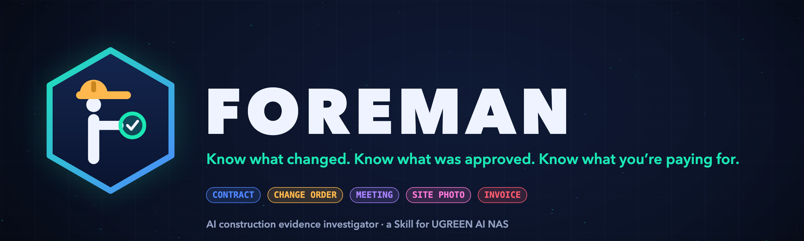
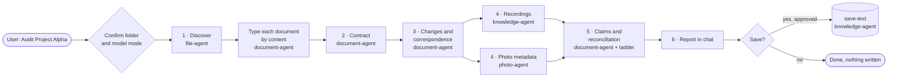
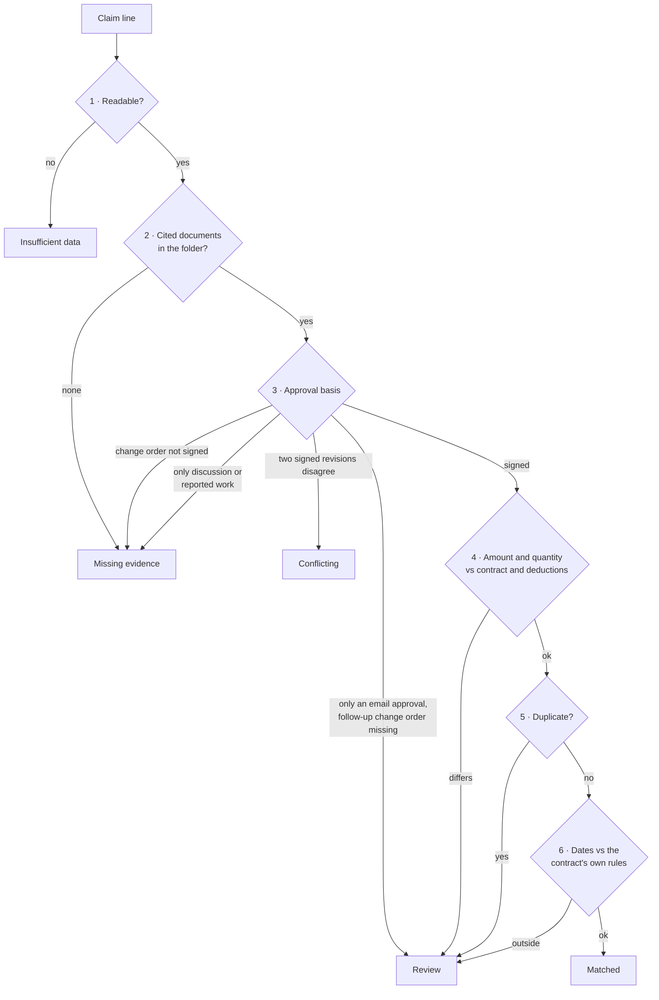

<p align="center">
  
</p>

<div align="center">
  <h1>FOREMAN</h1>
  <p><strong>An AI investigator Skill for UGREEN AI NAS that links every construction invoice to the contract, change orders, correspondence, meeting recordings and site photos, and shows the exact files behind every finding.</strong></p>
  <p><em>On a building site the foreman knows what was agreed, what was changed and what was actually built.<br>Foreman does the same for the project archive that already lives on your NAS.</em></p>
  <p>
    <a href="submission/submission-description.md"></a>
    <a href="https://ugreenhackathon.devpost.com/"></a>
    <a href="#see-it"></a>
  </p>
  <p>
    <a href="LICENSE"></a>
    
    
    
    
    
  </p>
  <p>
    
    
    
    
  </p>
  <p>
    <a href="submission/submission-description.md">Submission</a> ·
    <a href="skill/foreman/SKILL.md">SKILL.md</a> ·
    <a href="skill/validation/DRY_RUN_RESULTS.md">Dry-run results</a> ·
    <a href="dataset-v2/README.md">Test dataset</a> ·
    <a href="PRODUCT_FOREMAN.md">Product document</a>
  </p>
  <p><sub>Find the project files → read each record by its content → rebuild what was agreed, changed and claimed → reconcile every claim → report with exact source paths</sub></p>
</div>

> [!IMPORTANT]
> Foreman is a **Round 1 Skill package**. It has passed the official UGOS Skill Creation Tool checker and repeated **dry runs**: AI models stood in for the Uliya model, and the NAS expert results were simulated from a synthetic archive. It has **not yet run on a UGREEN AI NAS**; that happens on the finalist test day. Foreman never decides fraud, legal entitlement or payment. It shows a person what to verify. See [Truth boundaries](#truth-boundaries).

<details>
<summary><kbd>Contents</kbd></summary>

- [At a glance](#-at-a-glance)
- [The problem](#the-problem)
- [Who it is for](#who-it-is-for)
- [See it](#see-it)
- [The Claim-to-Evidence Ledger](#the-claim-to-evidence-ledger)
- [How an investigation runs](#how-an-investigation-runs)
- [How a claim is classified](#how-a-claim-is-classified)
- [Validation](#validation)
- [Run and verify](#-run-and-verify)
- [Truth boundaries](#truth-boundaries)
- [Repository map](#repository-map)
- [License and attribution](#license-and-attribution)

</details>

## 🦺 At a glance

<table>
  <tr>
    <td width="20%" align="center"><strong>01 / FIND</strong><br><br>Every file in the one project folder you confirm, and nothing outside it.</td>
    <td width="20%" align="center"><strong>02 / READ</strong><br><br>Each document is identified by its content, not its file name: contract, change order, email, diary, invoice.</td>
    <td width="20%" align="center"><strong>03 / REBUILD</strong><br><br>What was agreed, changed, discussed and delivered, as one dated timeline.</td>
    <td width="20%" align="center"><strong>04 / RECONCILE</strong><br><br>Each claim goes through a fixed 8-step ladder: approval, amount, quantity, duplicate, dates.</td>
    <td width="20%" align="center"><strong>05 / REPORT</strong><br><br>Five classes, exact amounts and file paths. Saved only after you confirm.</td>
  </tr>
</table>

<p align="center"><sub>Matched · Review · Missing evidence · Conflicting · Insufficient data. And always: “No approval evidence found in the accessible project records,” never a guess.</sub></p>

## The problem

A contractor does extra work after a **verbal instruction** on site. Weeks later the invoice arrives, and the client asks a simple question: *who approved this?* The answer is somewhere in the archive. It might be in the contract, a change order nobody signed, a meeting recording, a diary entry, a delivery note or an email. But the records are not connected, so someone digs for days.

The stakes are real. Arcadis's 16th Construction Disputes Report (United States, 2025 data) puts the average claimed dispute value at **US$56.0M**, with an average of **12.2 months** to resolve. In 161 school renovation projects, change orders accounted for roughly **three-quarters of cost growth** (Shrestha & Zeleke, 2018). Arbitration research finds that the party with the most complete, contemporaneous records holds the advantage (Kangari, 1995).

Foreman asks a narrower question:

> Are we being asked to pay for work that was never properly approved, and what do the project records actually show?

## Who it is for

| | Team | What they keep on their NAS | What Foreman checks for them |
| --- | --- | --- | --- |
| 🦺 | **General contractors** | Contracts, change orders, invoices, payment applications | Billed work without a signed change order, duplicate charges |
| 🏢 | **Fit-out and renovation firms** | Many small jobs, changes every week | Verbal instructions that never became paperwork |
| 🔩 | **MEP subcontractors** | Site instructions, extra work, delivery notes | Work started before approval, late site-condition notices |
| 🧮 | **QS and cost consultants** | Payment claims, variations, certificates | Quantities above the contract, ignored deductions, retention arithmetic |

## See it

<p align="center">
  
</p>

<table>
  <tr>
    <td width="50%"><br><sub><strong>Who.</strong> Construction teams keep every project on their own NAS: contracts, change orders, invoices, recordings, site photos.</sub></td>
    <td width="50%"><br><sub><strong>The problem in one week.</strong> “Go ahead, we’ll sort the paperwork later,” then an $8,500 invoice, and no signed approval anywhere.</sub></td>
  </tr>
  <tr>
    <td width="50%"><br><sub><strong>Why it matters.</strong> Every figure is shown with its edition, region and data year.</sub></td>
    <td width="50%"><br><sub><strong>How it is built.</strong> Six stages and ten delegations to four registered NAS experts.</sub></td>
  </tr>
  <tr>
    <td width="50%"><br><sub><strong>Tested before the NAS.</strong> Dry runs on a 71-file synthetic archive with traps built in.</sub></td>
    <td width="50%"><br><sub><strong>Built for UGREEN AI NAS.</strong> Local model, read-only, and every finding links to an exact file.</sub></td>
  </tr>
</table>

## The Claim-to-Evidence Ledger

<p align="center">
  
</p>

Every claim gets one Ledger row that connects the five records:

| Record | What it tells us | Example from the test archive |
| --- | --- | --- |
| **Contract** | What was agreed | Doors and door hardware are excluded |
| **Change order or written approval** | What was formally changed | CO-004, $2,500, client signature blank |
| **Meeting recording or minutes** | What was discussed | “Please send the change order first” |
| **Site report, diary, delivery note, photo** | What was reported done | Doors delivered 9 Oct, three days before the request |
| **Invoice or payment application** | What is being claimed | INV-010, $8,500, $6,000 above the unsigned change order |

> **Verdict:** Missing evidence, also Review · *“No approval evidence found in the accessible project records.”* · Recommended action: locate the signed CO-004 or the 13 October email before the invoice is accepted.

## How an investigation runs



| Stage | Expert | CLI | Effect |
| --- | --- | --- | --- |
| Discover | `file-agent` | `ug-filesystem` ls / find / stat | read |
| Document typing, contract, changes, correspondence, claims | `document-agent` | `ug-document` metadata / qa / extract / reconcile | read |
| Recordings | `knowledge-agent` | `ug-knowledge` audio-transcription | read |
| Photo dates and GPS | `photo-agent` | `ug-photo` meta / search-picture | read |
| Save report | `knowledge-agent` | `ug-knowledge` save-text | **write, approval: workflow** |

The parent Skill only uses `delegate --target <agent> --instruction '…'`. Each stage passes the **real upstream result** to the next, and every one of the five delegation states (`completed`, `failed`, `cancelled`, `waiting_user`, `waiting_approval`) is handled explicitly.

## How a claim is classified



The first step that raises a finding sets the class, and later steps add "also" classes. The full rules, the wording rules and the list of forbidden words (fraud, entitled, time-barred…) are in [`skill/foreman/references/evidence-rules.md`](skill/foreman/references/evidence-rules.md).

## Validation

| Check | Result |
| --- | --- |
| Official `check-skill.mjs` (UGOS Skill Creation Tool v0.7.3) | **static-pass**: 0 errors, 0 warnings, 0 info, also on the ZIP contents |
| Test archive | 3 projects, 71 files, 20 planted findings, 6 false-positive traps (scanned PDF, noisy and overlapping audio, GPS-tagged photos, colliding invoice numbers) |
| Dry-run round 1 | Full audits 1 of 2 (one run failed on totals); scoped Beta and Gamma runs 2 of 2 |
| Dry-run round 2 (after fixes) | Full audits **3 of 3** |
| Dry-run round 3 (final Skill) | Full audits **2 of 2**; single-invoice INV-010 **1 of 1** |
| Final runs | 14/14 issues found · 0 false positives · 20/20 classes · totals exact ($38,050 invoiced, $11,650 without approval evidence) |

Dry runs used Claude Haiku and Claude Sonnet as stand-ins for the Uliya model. The NAS expert results were simulated from the dataset files: PDF text, Vision OCR for the scan, whisper transcripts and EXIF. Every run got identical inputs, and the answer key was never visible to the model under test. Every round's problems and fixes are listed in [`skill/validation/DRY_RUN_RESULTS.md`](skill/validation/DRY_RUN_RESULTS.md).

## ⚡ Run and verify

The Skill package itself is plain Markdown. There is nothing to build:

```text
skill/foreman/
├── SKILL.md                      # entry point
└── references/
    ├── evidence-rules.md         # evidence types, classes, 8-step ladder, wording
    └── ledger-and-report.md      # Ledger fields, registers, totals, report template
```

Regenerate and verify the synthetic test archive (uses a virtual environment outside the project):

```sh
python3 -m venv "$SCRATCH/venv" && "$SCRATCH/venv/bin/pip" install -r dataset-v2/tools/requirements.txt
"$SCRATCH/venv/bin/python" dataset-v2/tools/generate_dataset.py dataset-v2
"$SCRATCH/venv/bin/python" dataset-v2/tools/verify_dataset.py dataset-v2 "$SCRATCH"
```

Build the Round 1 deliverables:

```sh
cd skill && zip -X -r ../submission/foreman.zip foreman -x '*.DS_Store'      # Skill ZIP (15 KB)
"$SCRATCH/venv/bin/python" submission/build_pdf.py submission/PROPOSAL.md submission/Foreman_Proposal.pdf
```

The teaser video, logo and GIFs are rendered in code by a local build script (skia-python, numpy, scipy, ffmpeg). The script and the video workspace are kept out of the repository; the finished GIFs and images are in [`submission/assets/`](submission/assets/), and the video is published on YouTube.

## Truth boundaries

- **Not yet run on a NAS.** All results are dry runs. UGREEN's real extraction, OCR, transcription and photo tools, and Uliya's local model, are validated only on the finalist test day.
- **An investigator, not a judge.** Foreman never says fraud, breach, entitled or time-barred, never approves or blocks a payment, and never changes project files.
- **Missing is not proof.** Not finding an approval document does not prove the approval never happened, so Foreman's wording is fixed: *“No approval evidence found in the accessible project records.”*
- **Scope is the confirmed folder.** A document with the same number in another project is never used as evidence.
- **Photos only corroborate.** Foreman uses their date and GPS; it never judges the work from the image.
- **Privacy.** With Uliya's local model, processing stays on the NAS. In cloud mode, content may be sent to the selected model, and Foreman says so before it starts.
- **Synthetic data.** Every party, address, amount and coordinate in the test archive is fictional.

## Repository map

| Path | Purpose |
| --- | --- |
| [`skill/foreman/`](skill/foreman/) | **The Skill package** (the only thing in the submission ZIP) |
| [`skill/DESIGN_NOTES.md`](skill/DESIGN_NOTES.md) | Capability verification against the kit catalog, design decisions, assumptions, checker rules |
| [`skill/validation/`](skill/validation/) | Official checker output and dry-run results for every round |
| [`dataset-v2/`](dataset-v2/) | Synthetic 3-project test archive, answer key, scoring sheet, generator, verifier |
| [`submission/`](submission/) | Proposal source, PDF builder, checklist, NAS-day plan, submission description, and the README/Devpost images and GIFs (the built PDF and Skill ZIP are not committed) |
| [`PRODUCT_FOREMAN.md`](PRODUCT_FOREMAN.md) | Full product document: problem research, design, scope, risks, plan |

## License and attribution

Foreman is licensed under [Apache-2.0](LICENSE).

- The logo, banner, GIFs, teaser video and its rock soundtrack are original. They were generated in code with skia-python, numpy, scipy and ffmpeg, using the macOS system fonts Avenir Next and Menlo; the render script is kept outside this repository.
- The test archive is synthetic and generated by [`dataset-v2/tools/generate_dataset.py`](dataset-v2/tools/generate_dataset.py). It contains no real documents, people or third-party data.
- The research figures are cited from Arcadis (16th Construction Disputes Report, United States, 2025 data), Shrestha & Zeleke (2018) and Kangari (1995). Full references and verification levels are in [`PRODUCT_FOREMAN.md`](PRODUCT_FOREMAN.md#64-evidence-base-independently-researched-2026-11-04).
- Foreman is an independent hackathon project. UGREEN, UGOS and Uliya are trademarks of their owner; no affiliation or endorsement is implied.
