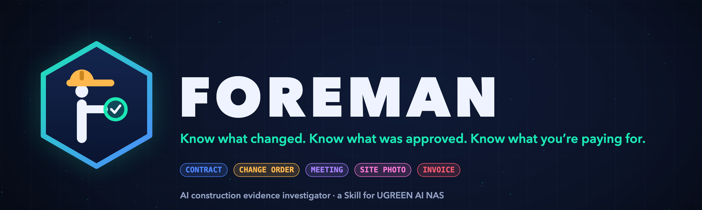
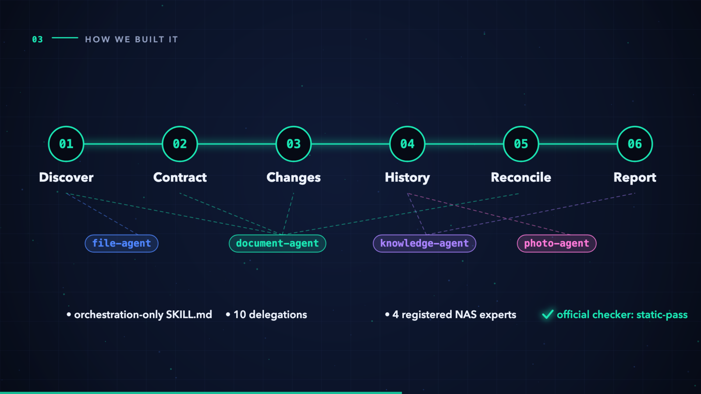

  

# Foreman

## Know what changed. Know what was approved. Know what you’re paying for.

**Foreman** is an AI investigator Skill for UGREEN AI NAS. It works on construction projects whose records already live on the NAS: the contract, change orders, emails, site diaries, meeting recordings, site photos and invoices. Ask “Audit Project Alpha” and Foreman connects all of them into a **Claim-to-Evidence Ledger**. For every invoice and payment claim it shows what was agreed, what was formally approved, what was only discussed, what was reported done, and what is being billed, with the **exact file** behind each statement.

  
  
  
  

## Inspiration

On a building site, the foreman is the person who knows what was agreed, what was changed and what was actually built. In the office, that knowledge is scattered.

A client says *“go ahead, we’ll sort the paperwork later.”* The crew does the extra work. Three weeks later an invoice arrives, and someone asks: *who approved this?* The answer is somewhere in the archive. It might be in a change order nobody signed, a meeting recording, a diary line or an email “to be filed”, but nothing connects them. So a project manager or quantity surveyor spends days rebuilding the story, usually after the money has been paid.

The cost is real:
- Arcadis’s 16th Construction Disputes Report (United States, 2025 data) gives an average **claimed** dispute value of **US$56.0M**, taking **12.2 months** to resolve.
- In 161 school renovation projects, change orders drove roughly **three-quarters of cost growth** (Shrestha & Zeleke, 2018).
- Arbitration research finds that the side with the most complete, contemporaneous records holds the advantage (Kangari, 1995).

Construction companies already keep these records on their own NAS. We wanted the NAS to do more than store them: to investigate them.

## What it does

  

| Foreman capability | What it does | Why it matters |
| --- | --- | --- |
| **1 · Find the project** | Lists every file in the one project folder you confirm, and identifies each document by its **content**, not its file name. | Real archives are messy: `CO_008 ACM removal.pdf`, `SiteDiary 24 Aug 26.pdf`, a superseded schedule in `from-tender/`. |
| **2 · Read the contract** | Builds an Original Scope Register: items, quantities, rates, exclusions, retention, and the contract’s own change and notice rules, quoted. | Every later check uses this project’s rules, not a generic standard form. |
| **3 · Track every change** | Builds a Change-Order Register with each party’s signature and date, and gives every statement an evidence type: formal approval, written approval, discussion, reported instruction or reported work. | A recording of “just do it” is never mistaken for a signed approval. |
| **4 · Rebuild the history** | Transcribes meeting recordings and reads photo dates and GPS into one dated Evidence Timeline. | It catches what people miss, such as doors delivered **before** they were requested. |
| **5 · Reconcile every claim** | Runs a fixed 8-step ladder on each invoice and payment-application line: approval, amount, quantity after deductions, duplicates, and dates against the contract. | It finds unapproved, duplicated, over-quantity and conflicting charges, with the arithmetic shown. |
| **6 · Report, then ask** | Shows the report with five classes and exact source paths. It saves back to the project folder **only after you confirm**. | Read-only by design; nothing is moved, tagged or deleted. |

## Product walkthrough

<table>
  <tr>
    <td width="50%"> <strong>Who it is for.</strong> General contractors, fit-out and renovation firms, MEP subcontractors, and QS and cost consultants, whose project records already live on their own NAS.</td>
    <td width="50%"> <strong>The problem in one week.</strong> A verbal go-ahead, extra doors installed, an $8,500 invoice, and no signed approval anywhere.</td>
  </tr>
  <tr>
    <td width="50%"> <strong>Why it matters.</strong> Research figures, each cited with edition, region and data year.</td>
    <td width="50%"> <strong>How it is built.</strong> Six stages and ten delegations to four registered NAS experts.</td>
  </tr>
  <tr>
    <td width="50%"> <strong>Tested before the NAS.</strong> A 71-file synthetic archive with planted problems and traps.</td>
    <td width="50%"> <strong>Built for UGREEN AI NAS.</strong> Local model, read-only, and every finding links to an exact file.</td>
  </tr>
</table>

## The Claim-to-Evidence Ledger

  

| INV-010 · $8,500.00 · 5 additional doors | Evidence | Source file |
| --- | --- | --- |
| Contract | Doors and door hardware are **excluded** | `01-Contract/CONTRACT-001_Original-Agreement.pdf` |
| Change order | CO-004 for $2,500.00, **client signature blank** | `02-Change-Orders/CO-004_Additional-Doors.pdf` |
| Discussion | “Please send the change order first, and I will review it.” | `04-Meetings/REC-2026-10-12.m4a` |
| Reported work | 5 doors delivered **9 Oct**, three days before the request | `12-Deliveries/DN-5531.pdf` |
| Missing | The “client email of 13 October” cited by the site report is not in the folder | `05-Site-Reports/SR-2026-10-15.pdf` |
| **Verdict** | **Missing evidence, also Review**: $6,000.00 above the unsigned change order. *“No approval evidence found in the accessible project records.”* | Action: locate the signed CO-004 or the 13 October email before the invoice is accepted |

**Five classes, always with a source path.** Matched · Review · Missing evidence · Conflicting · Insufficient data.

| Foreman will | Foreman will not |
| --- | --- |
| Show the discrepancy, why it matters and the exact file behind it. | Call anyone fraudulent or in breach, or say a party is entitled or not entitled to payment. |
| Say “No approval evidence found in the accessible project records.” | Claim an approval never happened, or invent a document’s content. |
| Mark two signed revisions as **Conflicting** and show both. | Pick one version silently. |
| Mark an unreadable scan or a 2-second recording as **Insufficient data**. | Guess an amount or fill gaps in a transcript. |

## How we built it

  

| Piece | Role in Foreman |
| --- | --- |
| **`SKILL.md`** | An orchestration-only Uliya Skill. It sends ten self-contained `delegate --target … --instruction '…'` calls to four registered experts, and each stage uses only the real upstream result. |
| **`file-agent` · `ug-filesystem`** | Discovery, scoped strictly to the confirmed project folder. |
| **`document-agent` · `ug-document`** | Typing documents by content, then reading the contract, change orders, correspondence and claims; `reconcile` is an optional cross-check. |
| **`knowledge-agent` · `ug-knowledge`** | Meeting transcription, and the single approved `save-text` write. |
| **`photo-agent` · `ug-photo`** | EXIF capture date and GPS, checked against the contract’s site reference point. |
| **`references/evidence-rules.md`** | Evidence types, the five classes, the 8-step ladder, required and forbidden wording. |
| **`references/ledger-and-report.md`** | Ledger fields, registers, totals and a fixed report template. |
| **Uliya model** | The local model is recommended, so contracts and prices stay on the NAS; the cloud-mode data flow is disclosed before every run. |

We verified every step against the kit’s capability catalog (v2.0.0) and read the official checker’s source to learn its exact rules. The package passes it with **0 errors, 0 warnings, 0 info**.

## Challenges we ran into

- **A recording is not an approval.** “Go ahead, we’ll sort the paperwork later” sounds like a yes. We built an evidence-type taxonomy so discussion, reported instructions and formal approvals can never be merged.
- **Email approval is approval, but incomplete.** One claim was approved only in an email, and the contract required a formal change order within 14 days that never came. It had to be *Review*, not *Missing evidence*. Dry runs caught us getting this wrong.
- **Deductions versus extras.** Claiming work that a signed change order removed is a different finding from claiming extra work. Both models first called it “no approval evidence”, so we rewrote the rule.
- **Messy archives.** File names lie, OCR reads `$4,400.00` as `$4.400.00`, a superseded schedule hides in a subfolder, and a sister project uses the same invoice numbers. Each of these became a rule and a test.
- **The checker is stricter than the docs.** Exact headings, the `→` arrow in capability evidence, and no “skip … approval” phrasing even when negated. We read its source rather than guess.

## Accomplishments we’re proud of

  

- A Skill that **passes the official checker first time** and does real cross-record reasoning, not document Q&A.
- A synthetic 3-project test archive with 71 files and **20 planted findings**. It includes six false-positive traps, a rotated noisy scan, a site walk with overlapping speakers, a 2-second voice memo, GPS-tagged photos and colliding invoice numbers. It has a scoring sheet fixed before testing.
- Three rounds of dry runs on two different models. The final Skill found **14/14 issues with 0 false positives**, classified **20/20** findings correctly and got every total exact. Two models gave the same answers.
- The dry runs also caught **two bugs in our own dataset**, documents dated before the events they cite, which we fixed in the generator.
- An original logo, a 30-second teaser and a rock soundtrack, all generated in code.

## What we learned

The hardest part of an AI investigator is not finding problems. It is **not inventing them**. The most valuable sentences in Foreman are the careful ones: “No approval evidence found in the accessible project records,” “these records disagree,” and “this file could not be read reliably.” Testing on a weaker model taught us more than testing on a strong one. Every ambiguity in our instructions showed up as a wrong class.

## What’s next

- **Finalist NAS day:** run the full audit on the iDX6011 Pro with Uliya’s local model, and measure real OCR, transcription and photo-metadata behavior.
- Handover reports and historical dispute reconstruction across multiple projects.
- Tagging evidence files after the user confirms, so a finding’s files can be reopened in one click.

## Honest limits

- **Dry runs, not NAS runs.** Claude Haiku and Claude Sonnet stood in for the Uliya model, and expert results were simulated from the dataset files. UGREEN’s real tools are untested until the finalist day.
- **Synthetic data.** Every party, amount, address and coordinate is fictional; no real project records were used.
- **No legal judgement.** Foreman reports documentary discrepancies for a person to verify. It never decides fraud, breach, entitlement or payment.
- **Photos corroborate only.** Dates and GPS are used; image content is not judged.

## Try it

- **Source:** [github.com/azharizz/Foreman](https://github.com/azharizz/Foreman)
- **The Skill:** [`skill/foreman/SKILL.md`](https://github.com/azharizz/Foreman/blob/main/skill/foreman/SKILL.md) and its two references
- **Test archive and answer key:** [`dataset-v2/`](https://github.com/azharizz/Foreman/tree/main/dataset-v2)
- **Dry-run results:** [`skill/validation/DRY_RUN_RESULTS.md`](https://github.com/azharizz/Foreman/blob/main/skill/validation/DRY_RUN_RESULTS.md)
- **Product document:** [`PRODUCT_FOREMAN.md`](https://github.com/azharizz/Foreman/blob/main/PRODUCT_FOREMAN.md)

All visuals, the logo, the teaser and its soundtrack are original and generated in code. The test data is synthetic. UGREEN, UGOS and Uliya are trademarks of their owner; no affiliation or endorsement is implied.
